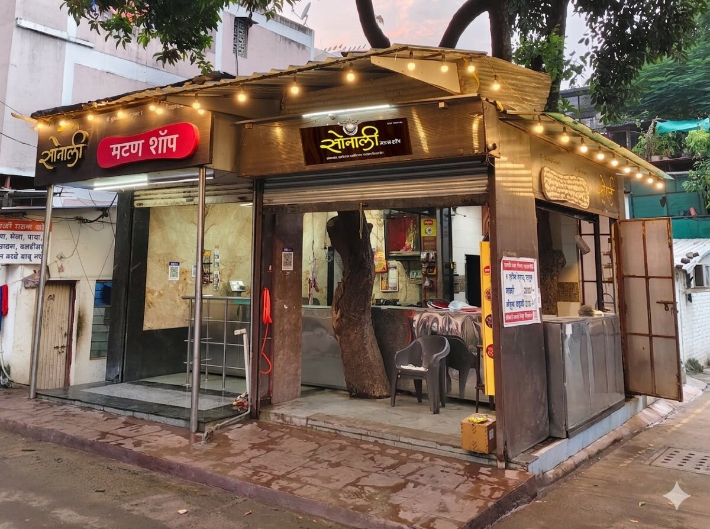
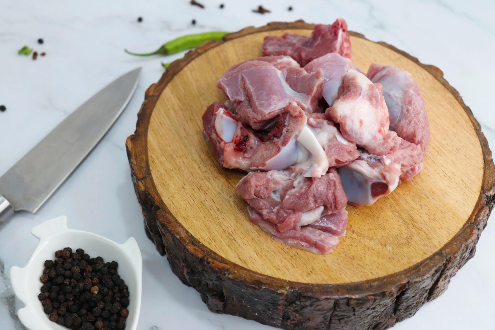

# 🐐 Sonali Mutton Shop

A full-featured, bilingual e-commerce and retail management web application developed for **Sonali Mutton Shop**, showcasing custom PHP development, MySQL database design, dynamic product catalogs, and administrative management.

[](https://www.php.net/)
[](https://www.mysql.com/)
[](LICENSE)
[]()

---

## 📌 Project Overview

**Sonali Mutton Shop** is a custom web application tailored for a local fresh meat enterprise. It streamlines retail sales, online customer ordering, product catalog discovery, multilingual customer engagement (English & Marathi), and backend administrative order processing.

This repository serves as a **public portfolio showcase**, featuring architectural documentation, sanitized code samples, and interface screenshots that illustrate backend engineering practices, database safety, and full-stack implementation.

---

## 🛠️ Technology Stack

| Layer | Technology | Details |
|---|---|---|
| **Backend** | PHP 8.x | Object-oriented & procedural PHP, session security, prepared statements |
| **Database** | MySQL / MariaDB | Relational schema, UTF-8 (`utf8mb4`), indexed product catalogs |
| **Frontend** | HTML5, CSS3, JavaScript | Custom responsive layout, mobile drawer navigation, dynamic DOM updates |
| **Styling & Icons** | Vanilla CSS, FontAwesome 6 | Custom modern themes, responsive CSS grid/flexbox |
| **Local Environment** | WAMP Server / Apache | Virtual host configuration, `.htaccess` URL routing, ngrok tunneling support |

---

## ✨ Key Features

- 🌐 **Bilingual Interface (English & Marathi):** Complete dual-language support with instant language switching and localized product fields (`name_mr`, `description_mr`).
- 🥩 **Dynamic Product Catalog & Filtering:** Real-time search, category filtering (e.g., Fresh Cuts, Kheema, Special Chops), price formatting, and pagination.
- 🛒 **Shopping Cart & Checkout Workflow:** Session-based and user-linked cart management with live quantity updates and order summary calculations.
- 📱 **Responsive Mobile-First Design:** Optimized touch navigation, mobile filter drawers, and WhatsApp direct-order integration.
- 🔒 **Security-First Architecture:** Parameterized queries, CSRF mitigations, strict input validation, SameSite session cookies, and XSS output escaping.
- 👨‍💼 **Administrative Dashboard:** Comprehensive management suite for products, categories, daily orders, customer feedback, and shop configuration.

---

## 📁 Repository Structure

```text
sonali-mutton-showcase/
├── README.md               # Main project documentation (this file)
├── LICENSE                 # Proprietary portfolio usage license
├── .gitignore              # Strict ignore rules for secrets, DB dumps & IDE files
├── docs/                   # Deep-dive technical documentation
│   ├── architecture.md     # System architecture, data flow & database schema
│   └── features.md         # Detailed breakdown of application capabilities
├── samples/                # Approved, sanitized PHP code samples
│   ├── 01-input-validation.php      # Form sanitization, regex & type safety
│   ├── 02-product-display.php       # Localization helper & safe HTML rendering
│   ├── 03-search-filter-logic.php   # Dynamic SQL query builder & pagination
│   ├── 04-safe-db-access.php        # MySQLi prepared statements & transactions
│   └── config.example.php           # Sanitized environment config template
└── screenshots/            # UI previews and application screenshots
    ├── 01-shop-hero-banner.jpg      # Storefront hero branding
    ├── 02-shop-logo.jpg             # Brand identity
    ├── 03-sample-product-mutton.jpg # Product card sample
    ├── 04-sample-product-kheema.jpeg# Kheema specialty cut
    └── README.md                    # Screenshot guide & capture instructions
```

---

## 💻 Code Samples Walkthrough

Selected modular samples are published in the [`samples/`](samples/) directory to demonstrate engineering standards without revealing proprietary business secrets:

| Sample | File | Core Concept Demonstrated |
|---|---|---|
| **Input Validation** | [`samples/01-input-validation.php`](samples/01-input-validation.php) | Cleans user input, validates phone/email formats, enforces length limits, and prevents injection. |
| **Product Display & Localization** | [`samples/02-product-display.php`](samples/02-product-display.php) | Demonstrates bilingual Marathi/English fallback rendering (`dbt()`), rupee currency formatting, and XSS defense. |
| **Search & Category Filter** | [`samples/03-search-filter-logic.php`](samples/03-search-filter-logic.php) | Dynamic query compilation with category integer filtering, keyword search matching, and safe pagination math. |
| **Safe Database Access** | [`samples/04-safe-db-access.php`](samples/04-safe-db-access.php) | Demonstrates parameterized queries, transactional checkout execution, and error handling. |
| **Sanitized Configuration** | [`samples/config.example.php`](samples/config.example.php) | Dynamic `SITE_URL` resolution across localhost/ngrok, secure session initialization, and clean credential placeholders. |

---

## 🖼️ Application Preview

Visual assets and screenshots are available in the [`screenshots/`](screenshots/) directory:

| Storefront Identity | Featured Product Preview |
|:---:|:---:|
|  |  |

> **Note:** For privacy and customer data protection, live customer telephone numbers, delivery addresses, transaction records, and administrative credentials have been excluded.

---

## 🔒 Security & Source Code Policy

This public repository is strictly an **evaluative portfolio showcase**:
- Production credentials, API tokens, and live database configurations are **excluded**.
- Database backups (`*.sql`), customer records, and internal sales data are **strictly omitted**.
- Full application source code and private administration routines are maintained in an offline, secure repository.

---

## 📄 License & Intellectual Property

Copyright (c) 2026 **Aawez Irfan Sayyed**. All rights reserved.

The materials in this repository are published solely for portfolio review and personal evaluation. Reproduction, redistribution, or commercial use without prior written consent from the author is strictly prohibited. See [LICENSE](LICENSE) for details.

---

## 📬 Contact & Inquiries

**Aawez Irfan Sayyed**  
- **GitHub:** [@aawezsayyed](https://github.com/sayyedawez)  
- **Role:** Full-Stack Web Developer & Software Engineer  
- **Inquiries:** Open for professional collaborations, web engineering roles, and custom application development.
