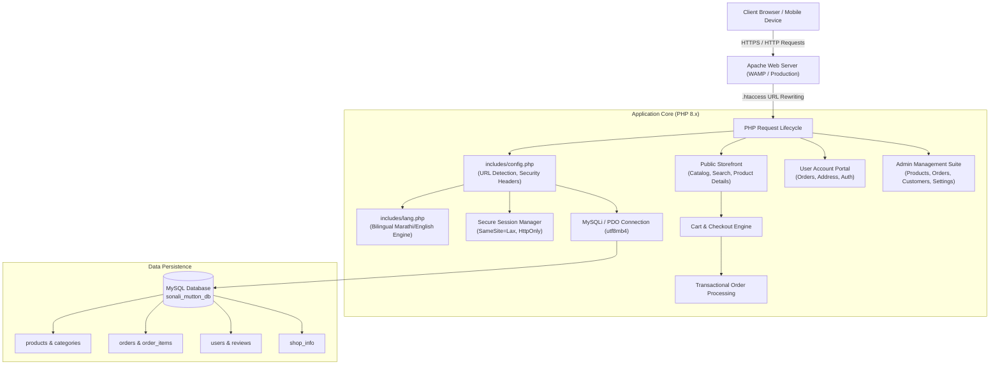
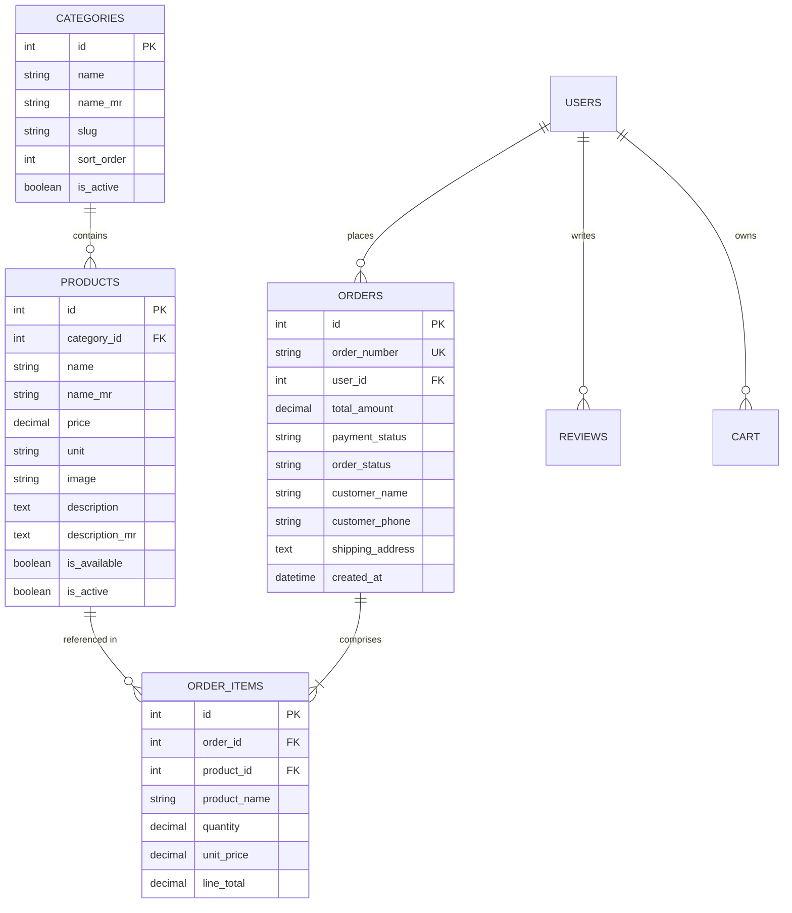

# 🏗️ Architecture & Technical Design

This document details the software architecture, data flow, and design patterns utilized in the **Sonali Mutton Shop** application.

---

## 1. System Architecture Overview

The application follows a modular Model-View-Controller (MVC)-inspired structure engineered natively with modern PHP, MySQL, and responsive frontend components.

---

## 2. Bilingual Localization Engine

One of the standout features of the application is native support for **Marathi (`mr`)** and **English (`en`)**:
1. **Interface Strings:** Stored as dictionary key-value maps in `includes/lang.php`.
2. **Database Fields:** Catalog items maintain dual columns (`name` and `name_mr`, `description` and `description_mr`).
3. **Fallback Helper:** The custom `dbt($row, 'field')` function checks the user's active session language. If Marathi is chosen and a Marathi value exists, it is served; otherwise, it seamlessly falls back to English.
4. **UTF-8 Support:** Database connections explicitly invoke `utf8mb4` charset configuration to preserve Marathi Unicode typography (Devanagari script).

---

## 3. Database Schema Design

The relational database schema is structured for performance, referential integrity, and customer tracking:

---

## 4. Security Highlights

- **SQL Injection Prevention:** Parameterized prepared statements (`$stmt->prepare()` and `$stmt->bind_param()`) for all dynamic queries.
- **Cross-Site Scripting (XSS) Mitigation:** Output escaping on all dynamic HTML strings with `htmlspecialchars($var, ENT_QUOTES, 'UTF-8')`.
- **Password Hashing:** Passwords encrypted using PHP's standard `password_hash()` algorithm (`BCRYPT` / `ARGON2ID`).
- **Session Protection:** Cookie hardening using `SameSite=Lax` and `HttpOnly` flags to mitigate CSRF and session hijacking.
- **Transactional Integrity:** ACID guarantees for order processing using `$conn->begin_transaction()`, committing only after all line items and cart operations succeed.
